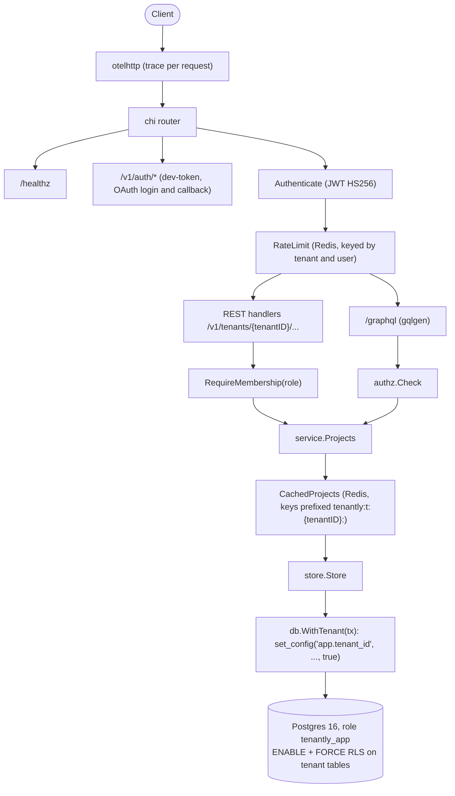

# Tenantly

[](https://github.com/iboondk/tenantly/actions/workflows/ci.yml)

Tenantly is the core of a multi-tenant SaaS API, written in Go on Postgres 16. Tenant isolation is enforced **inside the database** with Row-Level Security (RLS). A bug in an HTTP handler or resolver cannot read another tenant's rows, because the database returns zero rows for any tenant other than the one set on the transaction.

Around that core sit JWT and OAuth login, membership and role checks, a Redis rate limiter and cache, a GraphQL gateway next to REST, OpenTelemetry traces, and a k6 load test.

## Architecture



Isolation has three layers:

1. **Database (the boundary that matters).** Tenant-owned tables use `ENABLE` and `FORCE ROW LEVEL SECURITY`. A missing `app.tenant_id` yields zero rows, never an error and never all rows.
2. **Application.** `RequireMembership` and `authz.Check` confirm the caller belongs to the tenant and holds the required role. Non-members get `404`, so tenant IDs cannot be enumerated.
3. **Cache.** Every key starts with `tenantly:t:{tenantID}:`, and cache reads happen only after the membership check.

The full design is in [`docs/architecture.md`](docs/architecture.md). Decision records live in [`docs/adr/`](docs/adr/):

- [0001 Postgres RLS for tenant isolation](docs/adr/0001-postgres-rls-tenant-isolation.md)
- [0002 JWT, OAuth and membership](docs/adr/0002-auth-jwt-oauth-membership.md)
- [0003 Redis rate limit and cache](docs/adr/0003-redis-rate-limit-and-cache.md)
- [0004 GraphQL beside REST](docs/adr/0004-graphql-beside-rest.md)
- [0005 OpenTelemetry](docs/adr/0005-opentelemetry.md)

## Quick start

Prerequisites: Go (the version in `go.mod`), `make`, `curl` and `jq` for the examples, and Docker with Compose for the local Postgres and Redis services.

One command, after creating `.env`:

```sh
cp .env.example .env   # replace every changeme placeholder first
make up                # Postgres + Redis via Compose, migrations, app role, then the API on :8080
```

`make down` stops the containers. The same steps, one at a time:

```sh
# 1. Configuration. Replace every changeme placeholder before you use the file.
cp .env.example .env

# 2. Start Postgres 16 and Redis 7. Compose starts infrastructure only.
#    The API itself runs on the host (see step 4).
docker compose up -d

# 3. Create the schema. This also creates the tenantly_app role with NOLOGIN.
#    Then give tenantly_app a password so the API can connect as it.
set -a; . ./.env; set +a
make migrate ACTION=up
docker compose exec postgres sh /docker-entrypoint-initdb.d/01-app-role.sh

# 4. Run the API in dev mode, which serves POST /v1/auth/dev-token.
set -a; . ./.env; set +a
go run ./cmd/api
```

Check that it is up:

```sh
curl -s localhost:8080/healthz
# {"status":"ok"}
```

Try the isolation end to end with the dev token route (development only, `APP_ENV=dev`):

```sh
TOKEN=$(curl -s -X POST localhost:8080/v1/auth/dev-token \
  -H 'Content-Type: application/json' -d '{"email":"alice@example.test"}' | jq -r .token)

TENANT=$(curl -s -X POST localhost:8080/v1/tenants \
  -H "Authorization: Bearer $TOKEN" -H 'Content-Type: application/json' \
  -d '{"name":"Acme"}' | jq -r .id)

curl -s -X POST localhost:8080/v1/tenants/$TENANT/projects \
  -H "Authorization: Bearer $TOKEN" -H 'Content-Type: application/json' \
  -d '{"name":"Launch"}'

curl -s localhost:8080/v1/tenants/$TENANT/projects -H "Authorization: Bearer $TOKEN"
```

The full recording script is in [DEMO.md](DEMO.md).

### Without Docker

The test suite needs no Docker and no running services. It downloads Postgres 16 binaries (embedded-postgres) and runs Redis tests against miniredis. To point the tests at an existing server instead, set `TENANTLY_TEST_DATABASE_URL` to a superuser URL.

## Tests and CI

| Command | What it runs |
|---|---|
| `make up` / `make down` | Start the full local stack and API / stop the containers |
| `make build` | `go build ./...` |
| `make vet` | `go vet ./...` |
| `make test-rls` | RLS suite only. `TENANTLY_REQUIRE_DB=1`, so any skip fails the run |
| `make test` | Full suite, packages run serially (`go test -p 1`) |
| `make k6` | k6 load test (needs `k6` on `PATH` and a running API) |
| `make k6-report` | Markdown results table from `loadtest/results/summary.json` |

`.github/workflows/ci.yml` runs on every push to `main` and on every pull request. It builds, vets, checks `gofmt`, runs `make test-rls` (which must not skip), and runs `make test`.

## Repository layout

```
cmd/           api, migrate, k6report entry points
internal/      config, telemetry, db, store, auth, authz, service, cache,
               ratelimit, httpapi, graph, k6report
migrations/    goose SQL migrations (roles, core tables, RLS, auth functions)
loadtest/      k6 script and RESULTS.md template
deploy/        Postgres init script for the app role
docs/          architecture doc and decision records (adr/)
```

## Load test

`loadtest/RESULTS.md` is a template. Its values stay `TBD` until someone runs k6 against a live API and copies the rows from `make k6-report`. No numbers in this repository were estimated.

## Configuration

See [`.env.example`](.env.example). The variables that matter most are `APP_ENV` (`dev`, `test`, or `prod`), `DATABASE_URL`, `MIGRATE_DATABASE_URL`, `REDIS_URL`, `JWT_SECRET` (at least 32 bytes outside dev and test), `RATE_LIMIT_PER_MINUTE`, `CACHE_TTL`, and `OTEL_EXPORTER`.

## License

MIT. See [LICENSE](LICENSE). Copyright (c) 2026 iboondk.
